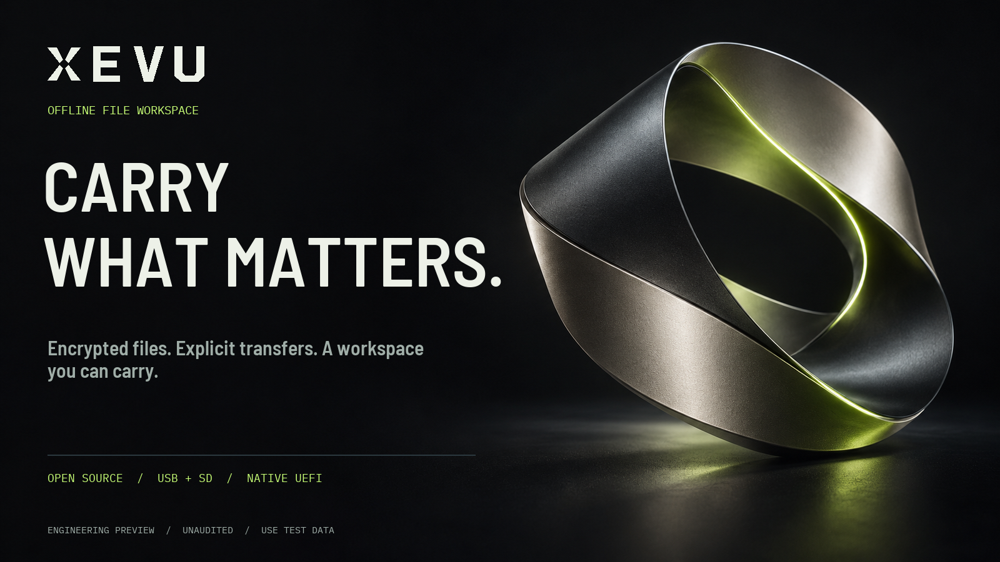
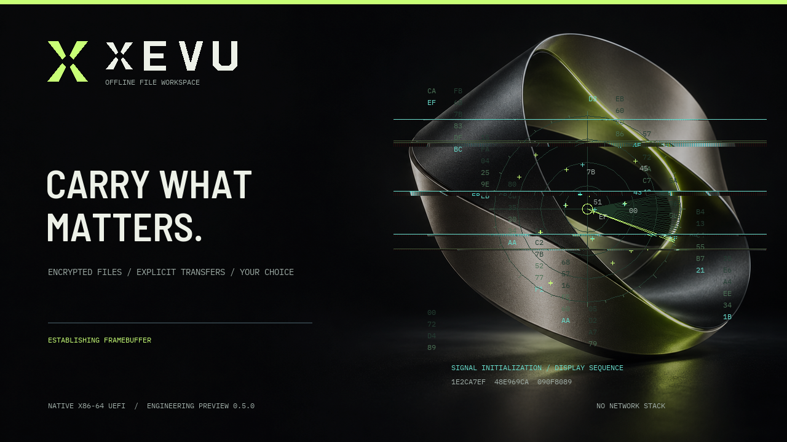

# XEVU

**Carry what matters.**

An open-source, offline file workspace for encrypted documents, media, project
files and personal archives. Boot from supported USB/SD media or explore the
native preview in a VM. Choose what enters. Decide what leaves.



**XEVU** is pronounced **zeh-voo**. The same workspace serves creative projects,
business documents, research, education and personal files. The name has no
industry-specific meaning.

[Brand and marketing kit](marketing/BRAND.md) · [Product sheet](output/pdf/xevu-product-sheet.pdf)
· [Launch copy](marketing/COPY.md) · [Source and releases](https://github.com/Teylersf/xevu)

## Current release: engineering preview 0.5.1

0.5.1 packages the tested native 0.5.0 build with a complete checksum manifest.
The 0.5 series introduces XEVU: a general-purpose identity, original vector logo, new boot
artwork and a complete marketing kit. Existing 0.3/0.4 VM vaults can be upgraded
with **UPGRADE XEVU VM.cmd**, retaining passwords, encrypted files and retry state.

This is a real x86-64 UEFI executable and bootable disk image, written in Rust
without Linux or a browser runtime. **It is a firmware-backed boot environment,
not a completed standalone kernel OS.** It keeps UEFI boot services active and
uses the firmware's disk, input, and framebuffer drivers. It has not been
independently audited and is not approved for classified information. Use public
test files until the limitations in [SECURITY.md](SECURITY.md) are resolved.

### Implemented

- Abstract boot artwork, native antialiased typography, a custom
  emblem, animated boot sequence, and keyboard/mouse operation.
- Glitch bursts, moving number cascades, a rotating field scope, live waveform
  graphics and a **Signal Lab** on page 6. Press **G** to disable motion, **Space**
  to hold its stream, and **R** to draw a fresh 256-bit public random sample.
  Samples come from firmware RNG or checked CPU RDRAND; animation uses a separate
  XChaCha20 stream and never receives vault keys. Scope graphics are simulated.
- Create/unlock a password-protected vault on the boot medium. Argon2id derives a
  wrapping key; a random master key protects individual authenticated objects.
- **Three consecutive failed native unlocks erase the entire boot card.** The
  persistent count resets after a correct unlock. Key destruction, a verified
  logical overwrite, boot-record invalidation, and shutdown are described in
  [the erasure policy](docs/ERASURE.md). Keep separate backups.
- Encrypted filenames and 64 KiB authenticated, padded data chunks using
  XChaCha20-Poly1305 and HKDF-SHA256. No secret key is embedded in the image.
- **E / Export original** restores the original filename and exact bytes onto a
  selected writable FAT USB/SD drive, after full authentication and readback
  verification. **SAVE FILES TO WINDOWS.cmd** delivers those files to a chosen
  Windows folder, including C:, through a virtual handoff drive.
- Other firmware FAT volumes have no application file access until selected in
  Drives. Imports open the source read-only, write encrypted copies, read them
  back, authenticate them, compare hashes, and revoke the source grant.
- Native PNG, JPEG, uncompressed 24/32-bit BMP, text with ASCII glyph coverage,
  converted PDF page images, and a bounded silent MJPEG format. Decrypted file
  buffers and keys use zeroizing wrappers.
- Explicitly selected removable destinations can receive an installed-image
  clone, with SHA-256 readback verification. Boot source, non-removable internal
  disks, undersized targets, and read-only targets are refused.
- Offline host CLI `xevuctl` for streaming preparation, verification, and explicit
  plaintext export. No hosted API, analytics, telemetry, or network stack.

### Not implemented / not claimed

- A standalone kernel, memory-protected userspace, viewer sandboxes, IOMMU device
  isolation, or a guarantee that firmware never probes internal disks.
- VLC, general MP4/H.264/H.265 playback, audio, native PDF/Office rendering, NTFS,
  exFAT, or ext filesystem drivers. Preparation tools convert PDF pages and
  supported FFmpeg inputs on a separate trusted computer into native payloads.
- Secure Boot signing/enrollment, a measured boot chain, a security audit,
  government accreditation, or resistance to malicious firmware/hardware.
- A new, proven cryptographic algorithm, post-quantum key exchange, anonymous
  internet delivery, guaranteed RAM erasure, anti-camera protection, or remote
  revocation. The file envelope is experimental and uses existing primitives.
- Physical validation on the Apollo Lake J3455 test PC. Emulator results do not
  establish real SD-reader, firmware, keyboard, or graphics compatibility.

## Try it on the J3455

Use an **empty USB stick or SD card of at least 256 MiB**, with 512-byte logical
sectors. Keep a backup of its contents. The release image has a 255 MiB FAT32
partition; the remaining card capacity is not automatically expanded or wiped.
A USB SD-card reader is the best first test: the PC's firmware must support
booting its built-in card slot for direct SD boot to work.

1. Download the release archive, extract it, and verify `SHA256SUMS.txt`.
2. Write `xevu-0.5.0-x86_64.img` using a trusted image writer. The included
   PowerShell writer defaults to **listing only**, refuses Windows boot/system
   disks, requires a selected disk identity, and verifies the image bytes.
3. Safely eject the card and insert it into the J3455 PC. Open its firmware boot
   menu and select the UEFI removable device. The build is unsigned; firmware
   configured to reject unsigned images will not run it. No firmware settings
   are changed automatically by this software.
4. Press **N** to create a vault; enter and repeat a long passphrase. There is no
   recovery backdoor. Press **U** to unlock an existing vault. **The third failed
   unlock destroys this whole card, including unused space, then shuts down.**
5. Insert another FAT-formatted source drive. Open **3 / Drives**, refresh,
   select a volume, and press Enter to grant temporary read access. Navigate to
   a file and press Enter to import an encrypted copy. Open **2 / Vault** to view.
6. To replicate, open **4 / Clone Drive**, select the exact removable destination,
   and type the displayed `CLONE <number>` phrase. Existing target contents are
   overwritten. Wait for readback verification and keep the secret separately.

| Key | Action |
| --- | --- |
| 1–6 | Overview, Vault, Drives, Clone Drive, About XEVU, Signal Lab |
| U / N | Unlock / create vault |
| E in Vault | Export the selected original as a normal decrypted file |
| Up / Down / Enter | Select / open / import |
| Backspace / Escape | Parent folder / revoke access or close viewer |
| R | Refresh devices; in Signal Lab, draw a fresh random sample |
| G | Toggle motion effects |
| Space in Signal Lab | Hold / resume the cosmetic stream |
| Space / Left / Right | Pause or seek field video / turn converted document pages |
| L / Q | Lock and revoke grants / shut down |

Locking wipes owned secret buffers as a best effort and clears the displayed
viewer. Firmware, decoder, allocator, and graphics copies can remain. The current
inactivity timer is based on event-loop ticks and is not a security-grade clock.

## Build on Windows

Install Rust stable with an MSVC linker and Python 3, then:

```powershell
rustup target add x86_64-unknown-uefi
.\tools\build.ps1
```

The source includes prepared artwork/font resources. Regenerating them with
`python tools/prepare_assets.py` additionally needs Pillow and downloads the two
OFL fonts when absent. Artwork provenance and the full prompt are in
[assets/ARTWORK.md](assets/ARTWORK.md). Building the image uses only Python's
standard library and never opens a physical drive.

```powershell
# List removable-media candidates; does not open or write any disk.
.\tools\write-media.ps1

# After positively identifying an empty card, run in elevated PowerShell 7:
.\tools\write-media.ps1 -DiskNumber NUMBER -ExpectedSerial 'EXACT_SERIAL'
# A reader without a serial can use its explicitly selected -ExpectedUniqueId.
```

Do not infer that a drive is disposable from its USB bus. USB hard drives can
contain important data. The writer does not sanitize old content beyond the
installed image. See the supported writer behavior and limitations in SECURITY.md.

## Prepare files on a trusted computer

### Export back to a normal PC file

Keep the original PDF/video when importing: native viewing conversion is optional
and is separate from storage/export. Raw originals export byte-for-byte without
conversion, even if the preview cannot display them.

For the VM, run **SAVE FILES TO WINDOWS.cmd**, choose a destination folder,
unlock the vault and press **2**, select a file, then **E**. Choose **WINDOWS_OUT**,
press Enter, type **EXPORT**, and press Enter. After exporting all desired files,
press **Q**; the Windows helper verifies and saves the normal files into that
folder. The helper does not receive a vault password/key. It keeps its console
open until the VM closes, then removes its temporary plaintext bridge on success.

On real hardware, choose a writable FAT32 USB/SD destination instead. Files appear
under `NULLGRAV_EXPORTS`. **Direct native NTFS C: writes are unsupported**; copy
from the FAT drive after Windows boots. Existing destination files are not
replaced. The encrypted vault copy remains. See **HOW TO EXPORT FILES.txt**.

### Easiest way to add Windows files to the running VM

1. Keep the XEVU VM open and double-click **ADD FILES TO XEVU VM.cmd**.
2. Select the files in the Windows picker. It attaches a **read-only virtual USB
   drive**, so no second physical USB stick or VM restart is needed.
3. In XEVU, press **N** to create a vault or **U** to unlock it. Press **3**,
   then **R**, select the **last non-boot FAT volume**, and press **Enter**.
4. Select a file and press **Enter** to encrypt/import it. Press **2** to see the
   vault, then Enter to open an imported file. Repeat for each file.

Your originals stay unchanged. A **plaintext transfer copy** remains under
`test-output/windows-imports` on the Windows computer; the vault copy is encrypted.
The latest transfer is attached again on VM restart. Existing boot/vault disks
are retained. Each batch allows up to 200 files / 200 MiB, with 128 MiB per file.
The preview vault itself has about **250 MiB total capacity**, including earlier
imports. PNG/JPEG/BMP and text open directly; PDF and ordinary video require
the preparation tools below for native viewing. See **HOW TO ADD FILES.txt**.
The picker needs Python 3 on Windows and the Ubuntu WSL used by the VM launcher.

### Command-line preparation

```powershell
xevuctl init PATH_TO_VAULT_DIRECTORY
xevuctl add PATH_TO_VAULT_DIRECTORY .\project.pdf .\project.png
xevuctl list PATH_TO_VAULT_DIRECTORY
xevuctl verify PATH_TO_VAULT_DIRECTORY
xevuctl extract PATH_TO_VAULT_DIRECTORY OBJECT.NGV .\explicit-plaintext-output.pdf
python tools/prepare_video.py input.mp4 output.ngm --seconds 30 --fps 10
python tools/prepare_document.py input.pdf output.ngd
```

Passphrases are prompted without echo and are never accepted as command-line
arguments. The native image has a `NULLGRAV/VAULT` directory after initialization.
Original encrypted PDFs can be transported and extracted. For native viewing,
prepare_document.py renders a PDF to an NGD page-image payload before encryption;
it requires PyMuPDF on the trusted preparation computer. This is not a native PDF
parser. Original files and converted payloads remain plaintext on that computer
until imported. Do not confuse storage support with viewing support.

## Emulator verification

QEMU + OVMF are required. On this Windows development host the QEMU tools run
under Ubuntu WSL; the shipped image itself contains no Linux components.

Double-click **TEST XEVU VM.cmd** to open a visible QEMU window with 4 GiB of
guest memory. This uses Ubuntu WSL and WSLg, with QEMU's GTK display backend.
Only virtual disks are attached; the physical SD card and Windows drives are not
passed through. Test files, a writable vault disk, and a clone destination persist
under `test-output/interactive-vm-0.5.0/`. Later launches resume those virtual disks.
If a 0.3 or 0.4 vault already exists, quit it with Q and run **UPGRADE XEVU VM.cmd**
first; the launcher refuses to replace it with an empty vault. Migration verifies
encrypted file readback and preserves both retry slots, without resetting them.
Older preview VM disks are kept separately. Three failed unlocks erase this
version's virtual boot card just as they would a physical boot card.
Use public test content. Press N to create a test vault, 1–6 to navigate, and Q
to shut down. This VM validates the software flow, not J3455/SD-reader compatibility.

Install the development VM dependencies inside Ubuntu if they are absent:

```sh
sudo apt-get install qemu-system-x86 qemu-system-gui ovmf
```

```powershell
wsl -d Ubuntu -- python3 /mnt/e/aicaller/tools/qemu.py run
wsl -d Ubuntu -- python3 /mnt/e/aicaller/tools/qemu.py capture dashboard
wsl -d Ubuntu -- python3 /mnt/e/aicaller/tools/qemu.py key 3
wsl -d Ubuntu -- python3 /mnt/e/aicaller/tools/qemu.py stop
```

`run` keeps a foreground WSL session attached until `stop` is called from another
terminal; `start` instead detaches the VM. Only generated regular-file images are
attached. A 64 MiB public-fixture source, a 384 MiB physical boot source with a
256 MiB installed image, and a disposable 256 MiB clone target are created under
ignored `test-output/`. The unallocated tail contains a synthetic marker used to
check that it is excluded from replication.
See [docs/VERIFICATION.md](docs/VERIFICATION.md) for the actual checked results.

## Source layout

| Path | Responsibility |
| --- | --- |
| `crates/field-boot` | Native UEFI entry, framebuffer UI, storage broker, viewers |
| `crates/vault-core` | no_std file encryption, bounded parsing, device policy |
| `crates/fieldctl` | Host streaming CLI and tests |
| `tools` | Image packaging, build, explicit media writer, QEMU, video conversion |
| `docs/FORMAT.md` | Exact public experimental envelope specification |
| `SECURITY.md` | Threat model, current trust boundaries, missing protections |

Project code is MIT licensed. Embedded fonts retain their OFL licenses under
`assets/fonts/`. Locked dependency license texts are included in
[THIRD_PARTY_NOTICES.md](THIRD_PARTY_NOTICES.md).

The native boot screen is shown below. The emblem is also available as
[a transparent vector asset](assets/brand/xevu-mark-lime.svg).



## Rebranding and existing vaults

XEVU continues the earlier NULLGRAV preview. The version-1 on-disk identifiers,
including `NULLGRAV/VAULT`, `NULLGRAV_EXPORTS`, `.NGV`/`.NGK` and the original
key-derivation namespace, are retained for compatibility. The visual rebrand
does not change your password, ciphertext or three-failure policy. Older root
launcher names remain compatibility aliases in a source checkout; new releases
use the XEVU launchers. Historical verification records keep their original
release names and hashes. See [the naming notes](marketing/NAME_RESEARCH.md).
